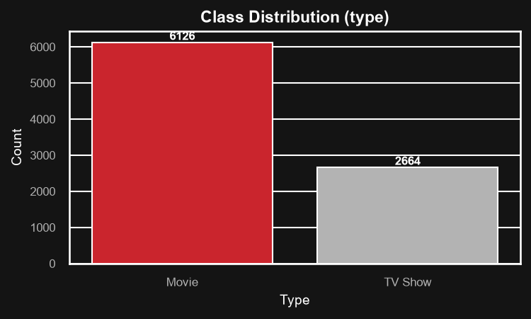
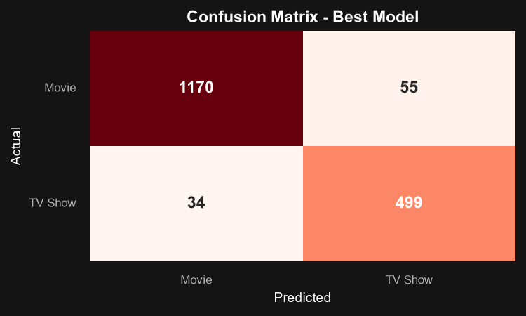
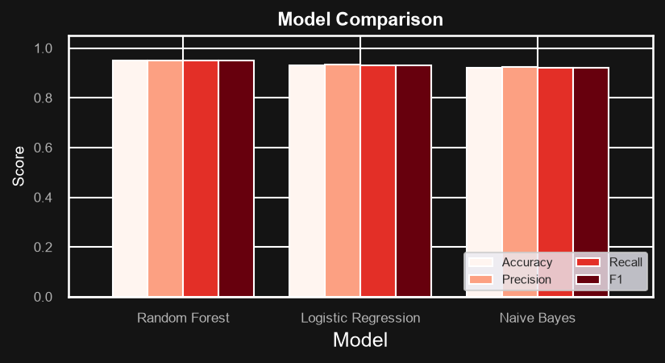
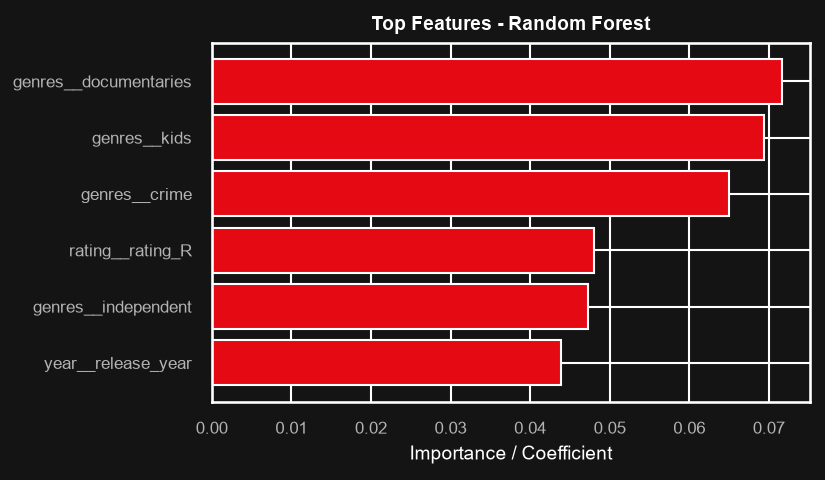

# 🎬 Netflix Content Type Prediction

Predict whether a Netflix title is a **Movie** or a **TV Show** using classical
machine learning (TF-IDF + scikit-learn), served through a Netflix-styled
Streamlit web app.

This is a beginner-friendly, end-to-end project: data cleaning → feature
engineering → model comparison → saved model → interactive web app.

---

## 📌 Project Overview

| Item | Detail |
|---|---|
| **Task** | Binary classification |
| **Target** | `type` → `Movie` / `TV Show` |
| **Dataset** | `dataset.csv` (Netflix titles) — 8,790 rows, 10 columns |
| **Models** | Logistic Regression, Random Forest, Multinomial Naive Bayes |
| **Best model** | Random Forest — **94.94% accuracy** |
| **Stack** | Python · pandas · scikit-learn · matplotlib/seaborn · Streamlit · joblib |

---

## 📂 Dataset

The dataset (`dataset.csv`) contains one row per Netflix title:

```
show_id, type, title, director, country, date_added,
release_year, rating, duration, listed_in
```

Quick facts discovered during inspection:

- **Rows:** 8,790
- **Class balance (imbalanced):**
  - `Movie` → 6,126 (69.7%)
  - `TV Show` → 2,664 (30.3%)
- **Missing values:** the bundled file is already clean (no `NaN`s), but
  `train_model.py` still handles gaps defensively so it also works on the
  original, messier Netflix dataset.

> **Note:** this dataset has **no `description` column**. The free-text
> `listed_in` (genres) field therefore plays the role of the description and is
> vectorised with TF-IDF — exactly like a description would have been.

---

## 🧠 Approach

1. **Cleaning**
   - Fill missing values (text → `"Unknown"` / `""`, `release_year` → median).
   - Parse `date_added` and extract `added_year`.
   - Keep only rows with a valid target.
2. **Feature engineering** (a single scikit-learn `ColumnTransformer`)
   - `listed_in` (genres) → **cleaned** of leaky words, then **TF-IDF** (max 4,000 features) — the main text signal
   - `country` → **TF-IDF** (max 600 features)
   - `rating` → **one-hot encoding**
   - `release_year` → scaled to `[0, 1]`
   - `added_year` → scaled, with a constant fallback for app input
3. **Split** — **stratified 80/20** train/test split (`random_state=42`) so the
   Movie / TV Show ratio is identical in both sets.
4. **Train & compare** 3 models, then pick the best by weighted **F1**.
5. **Save** the winning pipeline (preprocessing + classifier) with `joblib`.

---

## ⚠️ Data Leakage — the leakage fix

This project had a leakage problem: the models first scored **99.94%**, which is
a red flag. Three separate leaks were found and removed.

### 1. `duration` (always excluded)

It is literally the answer written out in text:

- `"90 min"` → **Movie**
- `"1 Season"` / `"2 Seasons"` → **TV Show**

### 2. Genre words (`listed_in`) — *cleaned before vectorising*

Netflix names TV genres with a `TV …` / `… Shows` convention:

| Class | Example genres |
|---|---|
| TV Show | `TV Dramas`, `Crime TV Shows`, `Reality TV`, `Docuseries` |
| Movie | `Dramas`, `International Movies`, `Romantic Movies` |

So merely seeing the token **"tv"** or **"movie"** predicted the label ~100% of
the time. `clean_genres()` strips every token containing
`movie / tv / show / series / stand-up / special` while **keeping the real genre
words** (drama, comedy, action, thriller, documentary, romance, …):

```
"TV Dramas, TV Mysteries"                -> "dramas mysteries"
"Dramas, International Movies"           -> "dramas international"
"Crime TV Shows, TV Action & Adventure"  -> "crime action adventure"
"Stand-Up Comedy"                        -> "comedy"
```

### 3. `director` — *dropped entirely*

A TF-IDF over director **names** alone scored **94.7% accuracy**. The model was
just memorising which directors work on movies vs. series — the same problem as
`title`: a high-cardinality identifier that does not generalise to unseen
titles. It is now excluded.

### Final exclusion list

```python
LEAKY_COLUMNS = ["duration", "show_id", "title", "director"]
LEAKY_GENRE_SUBSTRINGS = ("movie", "tv", "show", "series", "stand-up", "standup", "special")
```

Only genuinely predictive, generalisable metadata is used: **cleaned genres,
country, rating and year**. None of the excluded columns are referenced anywhere
in training or in `app.py`.

---

## 📊 Model Results

Test set: 1,758 titles (stratified 20% hold-out). Metrics are **weighted**
averages across both classes — a realistic range for this task.

| Model | Accuracy | Precision | Recall | F1 |
|---|---|---|---|---|
| **Random Forest** ✅ | **0.9494** | **0.9502** | **0.9494** | **0.9496** |
| Logistic Regression | 0.9306 | 0.9336 | 0.9306 | 0.9314 |
| Multinomial Naive Bayes | 0.9215 | 0.9230 | 0.9215 | 0.9193 |

**Best model → Random Forest**, saved to `model/best_model.pkl`.

For reference, here is what the *same* pipeline scored **before** the leakage fix
(kept only to document how big the leak was):

| Version | Accuracy |
|---|---|
| With leaky genre words (`TV …`, `… Movies`) | 99.94% |
| With genres cleaned | 98.35% |
| With genres cleaned **and** `director` removed | **94.94%** |

### Why is the accuracy still fairly high?

The residual signal is genuine, not leakage:

- some genre words really are one-sided (e.g. `mysteries`, `crime`, `reality`,
  `sitcoms`, `nature` appear only on TV shows; `documentaries`, `romantic`,
  `cult`, `classic` only on movies);
- `country` and `rating` correlate with content type in the real catalogue.

The remaining errors are mostly genuine Movie/TV-Show ambiguity, which is what we
want to see.

---

## 🚀 How to Run

> Requires **Python 3.9+**.

```bash
# 1. Install dependencies
pip install -r requirements.txt

# 2. Train the model (creates model/ and outputs/)
python train_model.py

# 3. Launch the web app
streamlit run app.py
```

The app opens at **http://localhost:8501**.

### Project structure

```
netflix content type prediction/
├── dataset.csv            # the dataset
├── requirements.txt       # dependencies
├── train_model.py         # cleaning, training, evaluation, charts
├── app.py                 # Streamlit web app
├── model/
│   └── best_model.pkl     # saved best pipeline (created by train_model.py)
├── outputs/               # charts + metrics table (created by train_model.py)
│   ├── class_distribution.png
│   ├── confusion_matrix.png
│   ├── model_comparison.png
│   ├── top_features.png
│   ├── model_metrics.csv
│   └── run_info.json      # best model / accuracy / F1 / test size (used by app.py)
├── README.md
└── .gitignore
```

---

## 📸 Screenshots

### Generated charts (in `outputs/`)

**Class distribution**



**Confusion matrix (best model)**



**Model comparison**



**Top features**



### App screenshots

The app is a **compact one-screen dashboard** (fits 1366×768 without scrolling):

- **Left (≈40%)** — the prediction form (description, then genre / country /
  rating / release year in a 2×2 grid), the *Predict* button and the result card
  (Movie or TV Show + confidence bar).
- **Right (≈60%)** — four metric cards (Best Model, Accuracy, F1, Test Samples)
  and the charts inside tabs: *Model Comparison*, *Confusion Matrix*,
  *Class Distribution*, *Top Features*.

Run `streamlit run app.py` and add your screenshot here:

```

```

---

## 🛠️ Notes & Possible Improvements

- Try dropping `rating` and the one-sided genre words to push the task even further.
- Add `GridSearchCV` hyper-parameter tuning.
- Add cross-validation for more robust metrics.
- Extend the app with batch CSV prediction or SHAP explanations.

---

*Built for educational purposes. Not affiliated with Netflix.*
